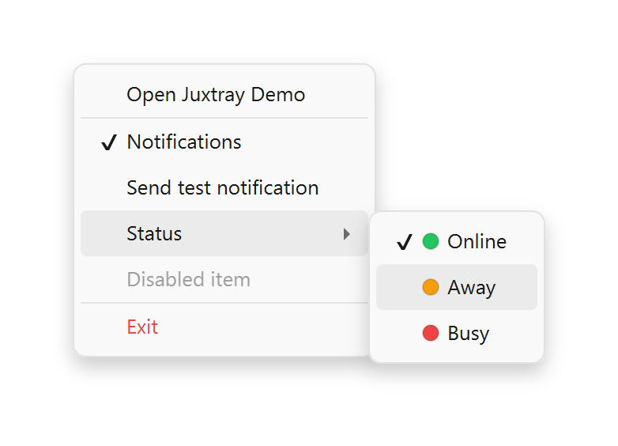
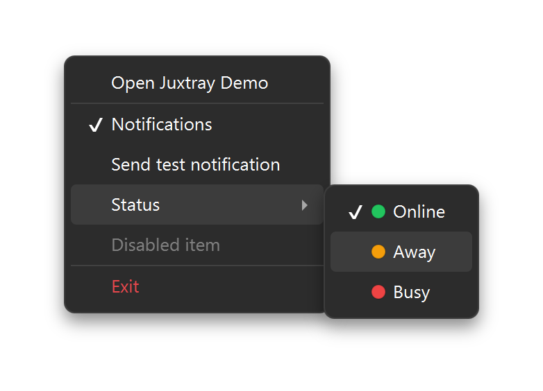
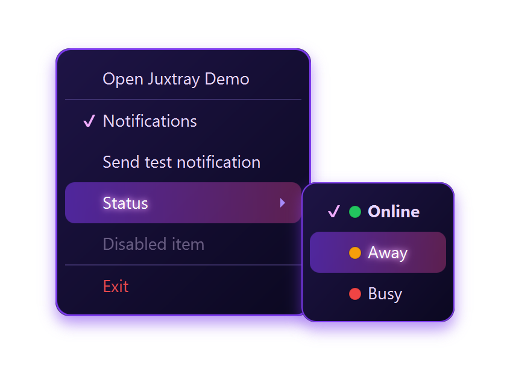
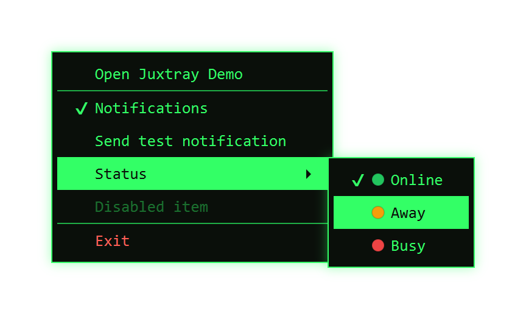
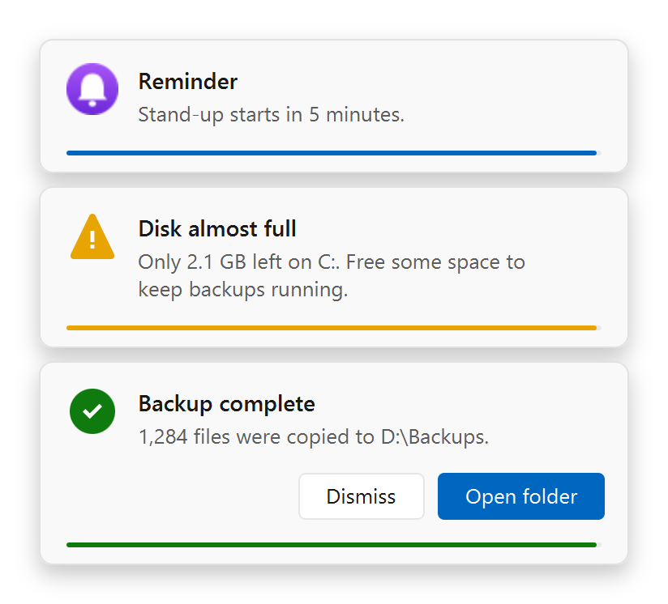
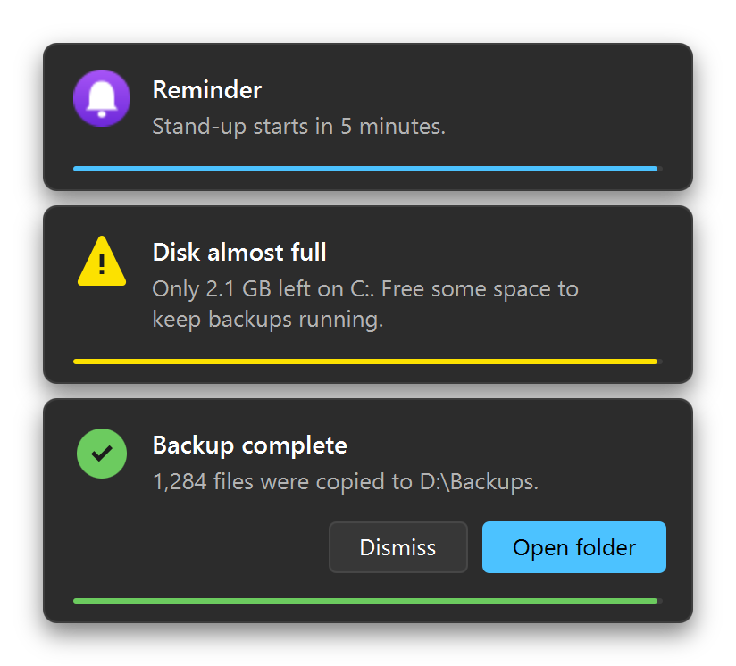
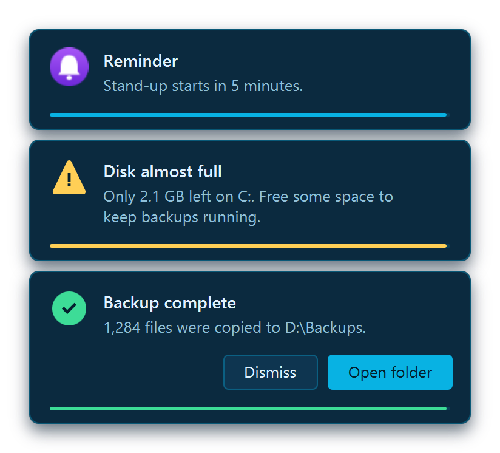
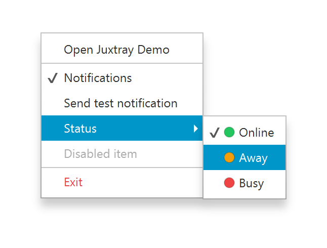

# Juxtray

**System tray icons for JavaFX: native where it must be, pure Java everywhere else.**

Built by **XTREME SOFTWARE SOLUTIONS**. Free and open source under the [MIT License](LICENSE): use it however you see fit, commercial or not.

Juxtray puts your JavaFX app in the system tray with a crisp, DPI-aware icon and a context menu that is a *real* JavaFX `ContextMenu`. That means you style it with plain JavaFX CSS: gradients, shadows, radii, fonts, pseudo-classes, custom items, anything.

It also shows **notifications** next to the tray: animated, stacked JavaFX popups with icons, action buttons, a countdown and your own sounds, styled with the same CSS. Point the tray at your app's scene, and the menu and notifications **follow your app's theme** live.

It is written in pure Java on the **Foreign Function & Memory API**. It has **no JNI and no bundled native libraries**, and nothing native to compile. The only native calls go straight into DLLs that ship with Windows.

    

> [!IMPORTANT]
> **Windows only for now.** Juxtray currently runs on **Windows 10 (1607+) and Windows 11**. macOS and Linux back ends are planned (see [Roadmap](#roadmap)). On other systems `Juxtray.isSupported()` returns `false` and creating a `TrayIcon` throws `TrayException`.

<table>
  <tr>
    <td align="center"><br><sub><b>Built-in · light</b></sub></td>
    <td align="center"><br><sub><b>Built-in · dark</b></sub></td>
  </tr>
  <tr>
    <td align="center"><br><sub><b>Custom CSS · Neon</b></sub></td>
    <td align="center"><br><sub><b>Custom CSS · Terminal</b></sub></td>
  </tr>
</table>

<sub>Every image is the <b>same</b> JavaFX <code>ContextMenu</code> from the demo, with only the stylesheets changed. The screenshots are rendered by the demo itself (<code>--screenshots</code>), not mocked up.</sub>

<table>
  <tr>
    <td align="center"><br><sub><b>Notifications · light</b></sub></td>
    <td align="center"><br><sub><b>Notifications · dark</b></sub></td>
    <td align="center"><br><sub><b>Following the app theme</b></sub></td>
  </tr>
</table>

---

## Contents

- [Features](#features)
- [CSS showcase](#css-showcase)
- [Platform support](#platform-support)
- [Requirements](#requirements)
- [Adding Juxtray to your project](#adding-juxtray-to-your-project)
- [Quick start](#quick-start)
- [The tray icon](#the-tray-icon)
- [Mouse events](#mouse-events)
- [The menu](#the-menu)
- [Styling the menu with CSS](#styling-the-menu-with-css)
- [Notifications](#notifications)
- [Following your app's theme](#following-your-apps-theme)
- [Icons and HiDPI](#icons-and-hidpi)
- [Threading and lifecycle](#threading-and-lifecycle)
- [API reference](#api-reference)
- [How it works](#how-it-works)
- [Demo](#demo)
- [Building from source](#building-from-source)
- [Roadmap](#roadmap)
- [License](#license)

---

## Features

**Tray icon**
- Any JavaFX `Image` as the icon, including images still loading in the background.
- Resampled in pure Java with a high-quality, premultiplied area-average filter, so the icon has no dark fringes or jaggies.
- **Per-monitor DPI aware:** sized for the scale of the monitor that actually shows the icon (16 px at 100 %, 24 px at 150 %, ...). It re-renders automatically when scaling or the monitor layout changes.
- Tooltip, show/hide without destroying, and live updates through JavaFX properties.
- Survives **Explorer restarts**: the icon re-adds itself when the taskbar comes back, even for elevated apps.
- No ghost icons: a shutdown hook removes icons the app forgot to close.

**Menu**
- A real JavaFX `ContextMenu`: `MenuItem`, `CheckMenuItem`, `RadioMenuItem`, `Menu` (submenus), `SeparatorMenuItem`, `CustomMenuItem`, item graphics, accelerator text, disabled items.
- **Fully CSS-stylable**, exactly like any JavaFX menu. Stylesheets are scoped to the tray, so they never leak into your app (or the other way round).
- **Built-in Windows 11-style theme** that follows the OS **light/dark** setting (or is forced either way with `setColorScheme`), with a colour palette exposed as CSS variables for two-line rethemes.
- **Native-like placement:** above a bottom taskbar, below a top one, beside a side one. It flips at screen edges, stays within the work area, works on every monitor (including negative coordinates), and is correct on mixed-DPI setups.
- Closes like a native tray menu: on item click, Escape, or a click anywhere else.
- Opens on right click (default), optionally on left click, or programmatically with `showMenu()`.

**Notifications**
- `tray.showNotification("Title", "Message", NotificationType.SUCCESS)`: one line, or a full `TrayNotification` with properties.
- **Animated:** slide, fade or zoom in and out (`NotificationAnimation`). The stack glides when a notification comes or goes.
- **Icons:** built-in info / success / warning / error badges drawn with CSS shapes, any `Image` (resampled sharply), any `Node`, or the tray icon itself.
- **Action buttons** (real JavaFX `Button`s), click-to-act, close button, and a countdown bar that **pauses on hover**.
- **Sounds:** a built-in chime per type (info, success, warning, error, plain), or your own WAV or MP3 per tray or per notification, with volume and a silent switch.
- **Live updates:** change the title, message, type or icon while it shows (progress, "done!").
- Stacks next to the taskbar automatically, or in any corner or edge centre; caps how many are open.
- Never steals the keyboard focus from the app you are typing in, and never appears in the taskbar or Alt+Tab.
- **Fully CSS-stylable** (`.tray-notification`, `:info`, `:success`, `:warning`, `:error` ...), with a built-in light/dark theme.

**Theming**
- `styleSource`: the menu and notifications follow your app's scene: its stylesheets, user-agent stylesheet, and root style classes / pseudo-classes. Switch your app to dark, and the open menu and notifications switch with it.

**Events**
- `onAction` for the classic "left click opens my window".
- `onTrayEvent` for everything: press/release per button, double-click, enter, move, exit. Each event carries the cursor position and icon bounds in JavaFX screen coordinates.
- Sealed record types, made for `switch` pattern matching.

**Engineering**
- JPMS module `xss.it.juxtray`. It exports only the public API; internals stay hidden.
- No dependencies besides JavaFX (`controls`, plus `media` for notification sounds).
- FFM entry points are confined to two classes. Upcalls are crash-proof (they never let an exception reach native code).

---

## CSS showcase

The tray menu is a plain JavaFX `ContextMenu`, so **every JavaFX CSS feature works**. The demo builds *one* menu, and each look below comes from stylesheets alone. Every shot shows the same things:
- a **check item** (`.check-menu-item`) and a **submenu** (`.menu`) opened on hover;
- **radio items** (`.radio-menu-item`) with **graphics** (coloured `Circle`s styled through their own class `.status-dot`);
- a **disabled item** (`:disabled`) and **separators** (`.separator`);
- an Exit item with an **app-specific style class** (`.danger`);
- **hover** (`:focused`) on the open row and on a submenu item.

### Built-in theme: light & dark

 

Zero CSS needed. It follows Windows' light/dark setting live, or you can pin it:

```java
tray.setColorScheme(ColorScheme.DARK);   // or LIGHT, or null to follow the OS
```

Your own classes still mix in. This is the demo's [`demo-menu.css`](demo/src/main/resources/xss/it/juxtray/demo/demo-menu.css), applied in every shot:

```css
.context-menu .menu-item.danger .label   { -fx-text-fill: #e5484d; }
.context-menu .menu-item.danger:focused  { -fx-background-color: rgba(229, 72, 77, 0.14); }
.context-menu .status-dot                { -fx-stroke: rgba(0, 0, 0, 0.15); }
```

```java
exit.getStyleClass().add("danger");
```

### Neon: retheme through variables, then go further


It starts by swapping the built-in palette variables, then adds what native menus can't do: a gradient background, a glowing border, gradient hover and glowing text. Full file: [`neon-menu.css`](demo/src/main/resources/xss/it/juxtray/demo/neon-menu.css).

```css
.context-menu {
    -tray-background: #140f2e;      /* built-in palette variables… */
    -tray-text: #e9d5ff;
    -tray-mark: #f0abfc;
    -tray-shadow: rgba(124, 58, 237, 0.55);

    -fx-background-color: linear-gradient(to bottom right, #1e1446, #0b0820);   /* …plus anything else */
    -fx-background-radius: 12;
    -fx-border-color: #7c3aed;
    -fx-border-radius: 12;
}

.context-menu .menu-item:focused {
    -fx-background-color: linear-gradient(to right, rgba(124, 58, 237, 0.55), rgba(236, 72, 153, 0.35));
}

.context-menu .menu-item:focused .label {
    -fx-text-fill: white;
    -fx-effect: dropshadow(gaussian, #f0abfc, 8, 0.3, 0, 0);
}

.context-menu .radio-menu-item:checked .label { -fx-font-weight: bold; }
```

### Terminal: a completely different look


Square corners, a monospace font, inverted selection, dashed separators and a phosphor glow. Full file: [`terminal-menu.css`](demo/src/main/resources/xss/it/juxtray/demo/terminal-menu.css).

```css
.context-menu {
    -tray-background: #0a0f0a;
    -tray-text: #33ff66;
    -tray-hover: #33ff66;           /* the selection is a solid green bar… */
    -fx-background-radius: 0;
    -fx-border-radius: 0;
    -fx-font-family: "Consolas";
    -fx-effect: dropshadow(gaussian, rgba(51, 255, 102, 0.35), 14, 0.2, 0, 0);
}

.context-menu .menu-item:focused .label,
.context-menu .menu:showing .label { -fx-text-fill: #0a0f0a; }   /* …with dark text on it */

.context-menu .separator-menu-item .line { -fx-border-style: dashed; }
```

### Plain JavaFX (Modena)



Turn the built-in theme off and you get stock JavaFX. Your own rules (like `.danger`) still apply:

```java
tray.setUseDefaultTheme(false);
```

---

## Platform support

| Platform | Status | Native strategy |
|---|---|---|
| **Windows 10 (1607+) / 11** | ✅ Implemented | FFM → `shell32`, `user32`, `shcore`, `kernel32` |
| macOS | 🗓️ Planned | FFM → Objective-C runtime / AppKit |
| Linux / BSD | 🗓️ Planned | **Pure Java** D-Bus (StatusNotifierItem), no native calls at all |

Use `Juxtray.isSupported()` to check at runtime.

---

## Requirements

- **JDK 25+**
- **JavaFX 25+**
- **Windows 10 version 1607 or later, or Windows 11.** Windows is the only supported OS for now.
- The JVM option **`--enable-native-access=xss.it.juxtray`** (FFM calls are restricted by default)
- JavaFX `base`, `graphics`, `controls` and `media` (the library's build brings them in)

---

## Adding Juxtray to your project

Juxtray is distributed as source, not through Maven. Pick one of the following:

**Option 1: as a subproject (recommended).** Copy (or `git submodule add`) the `juxtray/` folder into your build, then:

```groovy
// settings.gradle
include 'juxtray'
```

```groovy
// your app's build.gradle
dependencies {
    implementation project(':juxtray')
}
```

The library's own `build.gradle` brings JavaFX (`base`, `graphics`, `controls`, `media`) in for you. The demo in this repository is wired exactly this way.

**Option 2: as a jar.** Build it with `./gradlew :juxtray:jar` and put `juxtray/build/libs/juxtray-<version>.jar` on your module path, next to the JavaFX 25 modules.

Then, either way, add this to your `module-info.java`:

```java
module my.app {
    requires xss.it.juxtray;   // also gives you javafx.controls transitively
}
```

And grant native access when launching (Gradle `application` plugin shown):

```groovy
application {
    applicationDefaultJvmArgs = ['--enable-native-access=xss.it.juxtray,javafx.graphics,javafx.media']
}
```

(`javafx.graphics` and `javafx.media` are optional; they only silence JavaFX's own native-loading warnings.)

---

## Quick start

```java
import javafx.application.Application;
import javafx.application.Platform;
import javafx.scene.control.ContextMenu;
import javafx.scene.control.MenuItem;
import javafx.scene.control.SeparatorMenuItem;
import javafx.scene.image.Image;
import javafx.stage.Stage;
import xss.it.juxtray.TrayIcon;

public final class MyApp extends Application {

    private TrayIcon tray;

    @Override
    public void start(Stage stage) {
        // A tray app keeps running when its windows are closed.
        Platform.setImplicitExit(false);

        MenuItem open = new MenuItem("Open");
        open.setOnAction(e -> stage.show());

        MenuItem exit = new MenuItem("Exit");
        exit.setOnAction(e -> {
            tray.close();
            Platform.exit();
        });

        tray = new TrayIcon(
                new Image(getClass().getResource("icon-256.png").toExternalForm()),
                "My App",
                new ContextMenu(open, new SeparatorMenuItem(), exit));

        // Left click: bring the window back. Right click opens the menu by default.
        tray.setOnAction(e -> stage.show());
    }
}
```

---

## The tray icon

`TrayIcon` follows JavaFX conventions: constructors plus observable properties.

```java
TrayIcon tray = new TrayIcon();                              // empty slot
TrayIcon tray = new TrayIcon(image);
TrayIcon tray = new TrayIcon(image, "Tooltip");
TrayIcon tray = new TrayIcon(image, "Tooltip", contextMenu);
```

The icon appears **as soon as it is constructed** and stays until `close()` (or JVM exit).

```java
tray.setImage(otherImage);          // swap the icon (e.g. status changes)
tray.setTooltip("Syncing… 42%");    // Windows shows up to 127 characters
tray.setVisible(false);             // hide without destroying; setVisible(true) brings it back
tray.close();                       // remove for good and free native resources
```

Every setting is a property, so it binds:

```java
tray.tooltipProperty().bind(statusText);
visibleCheckBox.selectedProperty().bindBidirectional(tray.visibleProperty());
```

---

## Mouse events

### Simple: `onAction`

Fired when the **primary (left)** button is released over the icon:

```java
tray.setOnAction(e -> stage.show());
```

On a double-click it fires for each of the two clicks.

### Everything: `onTrayEvent`

```java
tray.setOnTrayEvent(event -> {
    switch (event) {
        case TrayIconEvent.Click c when c.state() == ButtonState.RELEASED
                && c.button() == MouseButton.MIDDLE -> toggleMute();
        case TrayIconEvent.DoubleClick d -> openMainWindow();
        case TrayIconEvent.Enter e -> showPreviewPopup(e.bounds());
        case TrayIconEvent.Exit e -> hidePreviewPopup();
        default -> { }
    }
});
```

| Event | Fields | When |
|---|---|---|
| `Click` | `button`, `state` (`PRESSED` / `RELEASED`), `position`, `bounds` | any button goes down or up |
| `DoubleClick` | `button`, `position`, `bounds` | double-click (the two `Click`s are reported too) |
| `Enter` | `position`, `bounds` | cursor entered the icon |
| `Move` | `position`, `bounds` | cursor moved over the icon (duplicates filtered) |
| `Exit` | `position`, `bounds` | cursor left the icon |

All events have `source()` (the `TrayIcon`). They are delivered **on the JavaFX Application Thread**.

- `position` is the cursor in **JavaFX screen coordinates**, so you can use it directly with `stage.setX/Y`.
- `bounds` is the icon's rectangle in the same space. It is `Rectangle2D.EMPTY` when Windows can't tell. While the icon is in the collapsed overflow area, Windows reports the "show hidden icons" chevron instead (you may see that on the `Exit` sent as the flyout closes).

---

## The menu

Pass any `ContextMenu`:

```java
CheckMenuItem notifications = new CheckMenuItem("Notifications");

Menu status = new Menu("Status");
ToggleGroup group = new ToggleGroup();
for (String s : List.of("Online", "Away", "Busy")) {
    RadioMenuItem item = new RadioMenuItem(s);
    item.setToggleGroup(group);
    status.getItems().add(item);
}

MenuItem quit = new MenuItem("Quit", new ImageView(powerIcon));   // graphics work too

tray.setContextMenu(new ContextMenu(notifications, status, new SeparatorMenuItem(), quit));
```

When the menu opens:

```java
tray.setMenuOnSecondaryClick(true);   // right click: default true
tray.setMenuOnPrimaryClick(true);     // left click:  default false
tray.showMenu();                      // open at the cursor programmatically
tray.hideMenu();
```

**Placement** mimics native tray menus. The menu opens above the cursor, starting at it, and is clamped into the screen's work area. On a bottom taskbar it sits just above the taskbar; on top or side taskbars it opens below or beside. It flips left at the right edge of the screen and works on any monitor at any scale.

**Closing:** choosing an item, pressing Escape, or clicking anywhere outside the menu closes it, like a native menu.

---

## Styling the menu with CSS

The menu is a standard JavaFX `ContextMenu`, so **all of JavaFX CSS applies**.

### Adding stylesheets

```java
tray.getStylesheets().add(getClass().getResource("tray.css").toExternalForm());
```

`TrayIcon.getStylesheets()` works like `Scene.getStylesheets()`, but it is **scoped to the tray menu**:

- Your application's scene stylesheets do **not** affect the tray menu, unless you opt in with a [style source](#following-your-apps-theme).
- Tray stylesheets do **not** leak into your windows.
- Changes apply at once, even to an open menu.
- The same stylesheets style the [notifications](#notifications).

### Selectors

| Selector | Targets |
|---|---|
| `.context-menu` | the menu container (also every submenu) |
| `.context-menu.tray-menu` | only the root tray menu |
| `.menu-item`, `.menu-item .label` | items and their text |
| `.menu` | items that open submenus; `.menu > .right-container > .arrow` is the arrow |
| `.check-menu-item`, `.radio-menu-item` | toggles; `> .left-container > .check` / `.radio` are the marks |
| `.separator-menu-item .line` | separators |
| `.accelerator-text` | shortcut text |
| `:focused`, `:pressed`, `:disabled`, `:checked`, `:showing` | states |
| `.your-class`, `#your-id` | anything you add with `getStyleClass()` / `setId()` |

Inline styles work too: `menu.setStyle(...)`, `item.setStyle(...)`.

### The built-in theme

A Windows 11-style theme is applied first and follows the OS light/dark setting automatically. Pin it with `tray.setColorScheme(ColorScheme.LIGHT)` or `ColorScheme.DARK`, or pass `null` to follow the OS again. It exposes its palette as **looked-up colours**, so a retheme can be this small:

```css
.context-menu {
    -tray-background: #1e1b4b;
    -tray-text: #e0e7ff;
    -tray-hover: rgba(167, 139, 250, 0.18);
}
```

| Variable | Used for |
|---|---|
| `-tray-background` | menu background |
| `-tray-border` | menu border |
| `-tray-text` | item text |
| `-tray-text-secondary` | accelerator text, submenu arrows |
| `-tray-hover` | focused item / open submenu background |
| `-tray-pressed` | pressed item background |
| `-tray-separator` | separator line |
| `-tray-mark` | check and radio marks |
| `-tray-shadow` | drop shadow colour |

(JavaFX only supports looked-up *colours*; sizes such as radii are set directly.)

To start from scratch on plain Modena instead:

```java
tray.setUseDefaultTheme(false);
```

### A bolder example

```css
.context-menu {
    -fx-background-color: linear-gradient(to bottom right, #1e1446, #0b0820);
    -fx-background-radius: 12;
    -fx-border-color: #7c3aed;
    -fx-border-radius: 12;
    -fx-effect: dropshadow(gaussian, rgba(124, 58, 237, 0.55), 18, 0, 0, 6);
}

.context-menu .menu-item {
    -fx-background-radius: 8;
    -fx-padding: 8 14 8 14;
}

.context-menu .menu-item:focused {
    -fx-background-color: linear-gradient(to right, rgba(124, 58, 237, 0.55), rgba(236, 72, 153, 0.35));
}

.context-menu .menu-item:focused .label {
    -fx-text-fill: white;
    -fx-effect: dropshadow(gaussian, #f0abfc, 8, 0.3, 0, 0);
}

.context-menu .menu-item.danger .label {
    -fx-text-fill: #f87171;
}
```

The full version ships in the demo: [`neon-menu.css`](demo/src/main/resources/xss/it/juxtray/demo/neon-menu.css).

---

## Notifications

```java
// One line:
tray.showNotification("Upload complete", "report.pdf is online.", NotificationType.SUCCESS);

// Or with everything:
TrayNotification n = new TrayNotification("Backup complete", "1,284 files copied.", NotificationType.SUCCESS);
Button open = new Button("Open folder");
open.setDefaultButton(true);                       // :default, drawn in the accent colour
open.setOnAction(e -> openFolder());
n.getActions().addAll(new Button("Dismiss"), open);
n.setOnAction(e -> stage.show());                  // click on the notification itself
n.setDuration(Duration.seconds(8));                // Duration.INDEFINITE = until closed
n.setSound(getClass().getResource("done.mp3").toExternalForm());
tray.showNotification(n);
```

Notifications are drawn by JavaFX, not by the OS, so they look the same everywhere and you style them with CSS like the menu. They are popups owned by an invisible, always-on-top helper window. That keeps them above other apps and out of the taskbar and Alt+Tab, and they **never take the keyboard focus** from whatever the user is typing in.

**Behaviour**
- They stack in the corner next to the taskbar (bottom-right for a bottom taskbar). Change that with `tray.setNotificationPosition(Pos.TOP_RIGHT)`; corners and edge centres are supported. Notifications always stack from the top or bottom edge, so a vertical part other than `TOP` means the bottom (`CENTER_LEFT` acts like `BOTTOM_LEFT`).
- The newest sits nearest the edge. When one closes, the others glide into place.
- `tray.setMaxNotifications(4)` (the default) caps the stack; the oldest closes when one more opens.
- A countdown bar runs down; **hovering pauses it**. Clicking the notification runs `onAction` and closes it, and so does choosing an action button (after the button's own handler).
- Everything is live: change `title`, `message`, `type`, `image`, `graphic`, `duration`, the actions or the style classes while it shows. The demo's **Live progress** button does exactly that.
- `onShown`, `onHidden`, `showing`, `hide()`, and `tray.hideNotifications()` for all of them. Showing a notification again while it is still fading out brings it straight back: `onHidden` fires first, then `onShown`.

**Animations:** `tray.setNotificationAnimation(...)` with `SLIDE` (default: slides in from the nearest screen edge), `FADE`, `ZOOM` or `NONE`.

**Icons:** the first that is set wins: `graphic` (any `Node`) → `image` (any `Image`, resampled with the same high-quality filter as the tray icon) → the type's built-in badge (`INFO`, `SUCCESS`, `WARNING`, `ERROR`) → the tray icon's own image (`NONE`).

**Sounds:** out of the box, every type has its own short built-in chime: a soft rising one for `NONE`, a clear bell for `INFO`, an ascending arpeggio for `SUCCESS`, a double tone for `WARNING` and a falling tone for `ERROR`. Replace them with any WAV or MP3 that JavaFX Media plays, from any URL (`jar:`, `file:`, `http:` ...):

```java
tray.setNotificationSound(getClass().getResource("chime.wav").toExternalForm()); // for all notifications
tray.setNotificationVolume(0.7);                                                 // 0..1
n.setSound(Path.of("C:/sounds/alert.mp3").toUri().toString());                   // this one only
n.setSilent(true);                                                               // this one: no sound
tray.setUseDefaultSounds(false);                                                 // no built-in sounds
```

The first that applies wins: `silent` → the notification's `sound` → the tray's `notificationSound` → the built-in sound of the type (while `useDefaultSounds` is on). Clips are decoded once and cached. A file that cannot be played is logged and skipped, so it never breaks the notification.

### Styling notifications

| Selector | Targets |
|---|---|
| `.tray-notification` | the notification (plus your `getStyleClass()` classes) |
| `:info`, `:success`, `:warning`, `:error` | the notification's type |
| `:hover` | while the mouse is over it |
| `.notification-graphic` | the icon box (its `-fx-pref-width` sets the image size) |
| `.notification-icon`, `.notification-glyph` | the built-in badge and its symbol (both `-fx-shape`, so restyle or reshape them) |
| `.notification-title`, `.notification-message` | the texts |
| `.notification-close`, `.notification-close-icon` | the close button (fades in on hover) |
| `.notification-actions`, `.notification-action` | the button row and its buttons; `:default` for the main one |
| `.notification-timer`, `.notification-timer-bar` | the countdown track and bar |

The built-in theme has its own palette on `.tray-notification`: `-tray-background`, `-tray-border`, `-tray-text`, `-tray-text-secondary`, `-tray-accent`, `-tray-info`, `-tray-success`, `-tray-warning`, `-tray-error`, `-tray-glyph`, `-tray-button`, `-tray-track` and more. To retheme menu and notifications together:

```css
.context-menu, .tray-notification {
    -tray-background: #1e1b4b;
    -tray-text: #e0e7ff;
    -tray-accent: #a78bfa;
}
```

---

## Following your app's theme

Most apps let users pick a theme. Make the tray follow it with one line:

```java
tray.styleSourceProperty().bind(stage.sceneProperty());
```

From then on, the menu, its submenus and the notifications get, **live**:

- the scene's **stylesheets** (after the built-in theme, before `tray.getStylesheets()`);
- the scene's **user-agent stylesheet**;
- the scene root's **style classes**, **inline style** and **pseudo-classes**, copied onto the root of each tray popup.

So the usual theme-switching patterns just work, including for a menu or notification that is open at that moment:

```css
/* app.css: your app's own stylesheet */
.root.dark { -fx-base: #2b2b2b; }

.root.dark .context-menu,
.root.dark .tray-notification {
    -tray-background: #262626;
    -tray-text: #f2f2f2;
    -tray-accent: #7c9cff;
}
```

```java
scene.getRoot().getStyleClass().add("dark");   // the app, its tray menu and notifications turn dark
```

Your app's rules only reach the tray where they mention its selectors or its `-tray-*` colours, so your existing CSS will not suddenly restyle the menu. To let your theme decide everything, also call `tray.setUseDefaultTheme(false)`. Themes installed globally with `Application.setUserAgentStylesheet(...)` (AtlantaFX and the like) reach the tray even without a style source.

---

## Icons and HiDPI

- Supply a **large, square** image (256×256 is ideal). Juxtray resamples it to the exact pixel size Windows wants, so it looks sharp at every scale.
- Non-square images are fitted and centred on a transparent background.
- Images loading in the background (`new Image(url, true)`) are applied once loaded. Load errors are logged, not thrown.
- Juxtray picks the size from the DPI of the monitor that actually shows the tray, not the "system DPI". After you change display scaling or rearrange monitors, the icon re-renders within about half a second.
- Changing the icon at runtime (status indicators, progress, badges) is cheap: just call `setImage(...)`.

Generating icons in code is easy with a `Canvas` snapshot:

```java
Canvas canvas = new Canvas(256, 256);
GraphicsContext g = canvas.getGraphicsContext2D();
g.setFill(Color.web("#22c55e"));
g.fillRoundRect(8, 8, 240, 240, 72, 72);
SnapshotParameters params = new SnapshotParameters();
params.setFill(Color.TRANSPARENT);
tray.setImage(canvas.snapshot(params, null));
```

---

## Threading and lifecycle

- **Use `TrayIcon` on the JavaFX Application Thread only**, after the JavaFX runtime has started. That covers constructing it, setters, `showMenu`, and `close`. Calling from another thread throws `IllegalStateException`. From a background thread, wrap calls in `Platform.runLater`.
- **Handlers run on the JavaFX Application Thread**, so you can touch the UI directly.
- **Call `Platform.setImplicitExit(false)`** in tray apps. Otherwise JavaFX exits when the last window closes, and an invisible helper window that hosts the menu counts as a window.
- **`close()` removes the icon.** If the JVM exits without it, a shutdown hook removes leftover icons, so no "ghost" icon stays in the taskbar.
- Juxtray never calls `Platform.exit()` itself.

---

## API reference

Package `xss.it.juxtray` (the only exported package):

| Type | Purpose |
|---|---|
| `TrayIcon` | the tray icon: properties, events, menu, lifecycle |
| `TrayIconEvent` | sealed event hierarchy: `Click`, `DoubleClick`, `Enter`, `Move`, `Exit` |
| `TrayNotification` | a notification: title, message, type, icon, actions, duration, sound, events |
| `NotificationType` | `NONE`, `INFO`, `SUCCESS`, `WARNING`, `ERROR` (icon and CSS pseudo-class) |
| `NotificationAnimation` | `SLIDE`, `FADE`, `ZOOM`, `NONE` |
| `ButtonState` | `PRESSED` / `RELEASED` |
| `TrayException` | unchecked; the OS refused an operation, or the platform is unsupported |
| `Juxtray` | `isSupported()` |

`TrayIcon` members:

| Property / method | Type | Default | Notes |
|---|---|---|---|
| `image` | `Image` | `null` | resampled to the tray size |
| `tooltip` | `String` | `null` | max 127 chars shown |
| `visible` | `boolean` | `true` | hide without destroying |
| `contextMenu` | `ContextMenu` | `null` | any JavaFX context menu |
| `menuOnPrimaryClick` | `boolean` | `false` | left click opens the menu |
| `menuOnSecondaryClick` | `boolean` | `true` | right click opens the menu |
| `useDefaultTheme` | `boolean` | `true` | built-in light/dark menu theme |
| `colorScheme` | `ColorScheme` | `null` | force the built-in themes (menu and notifications) light/dark; `null` follows the OS |
| `styleSource` | `Scene` | `null` | app scene whose styles the menu and notifications follow |
| `onAction` | `EventHandler<ActionEvent>` | `null` | primary click released |
| `onTrayEvent` | `Consumer<? super TrayIconEvent>` | `null` | all mouse events |
| `getStylesheets()` | `ObservableList<String>` | empty | menu and notification stylesheets (scoped to the tray) |
| `showMenu()` / `hideMenu()` | | | open at cursor / close |
| `showNotification(...)` | | | show a `TrayNotification`, or build one from title, message (and type) |
| `hideNotifications()` | | | close all open notifications |
| `notificationPosition` | `Pos` | `null` | where they stack; `null` = next to the taskbar |
| `notificationAnimation` | `NotificationAnimation` | `SLIDE` | how they appear and disappear |
| `maxNotifications` | `int` | `4` | open at once; the oldest closes first |
| `notificationSound` | `String` (URL) | `null` | WAV/MP3 for all notifications; `null` = built-in per type |
| `useDefaultSounds` | `boolean` | `true` | built-in per-type sounds when nothing else is set |
| `notificationVolume` | `double` | `1.0` | 0 to 1 |
| `close()` / `isClosed()` | | | remove the icon, free resources |

Full Javadoc: `./gradlew :juxtray:javadoc` → `juxtray/build/docs/javadoc/index.html`.

---

## How it works

```
your app ──► xss.it.juxtray.TrayIcon           (public API, JavaFX properties & events)
                 │
                 ├── MenuPlacement, NotificationPlacement, PixelScaler
                 │                               pure Java: placement math, icon resampling
                 ├── MenuHost                    pure JavaFX: hosts & places the ContextMenu
                 ├── NotificationHost            pure JavaFX: builds, stacks & animates notifications
                 ├── StyleLink                   pure JavaFX: theme + style source → every tray popup, live
                 ▼
             NativeTray                          tiny internal SPI per platform
                 ▼
             WinTray / WinTrayHost               Windows back end, FFM only
                 ▼
             shell32 · user32 · shcore · kernel32   (DLLs that ship with Windows)
```

**What is native, exactly?** Only the calls that cannot be avoided. Windows exposes the notification area solely through `Shell_NotifyIconW`, which needs a window to receive callbacks:

| DLL | Functions | Why |
|---|---|---|
| `shell32` | `Shell_NotifyIconW`, `Shell_NotifyIconGetRect` | add/modify/remove the icon, find its position |
| `user32` | `RegisterClassExW`, `CreateWindowExW`, `DefWindowProcW`, `GetMessageW`, `TranslateMessage`, `DispatchMessageW`, `PostMessageW` | hidden callback window + message loop |
| `user32` | `RegisterWindowMessageW`, `ChangeWindowMessageFilterEx` | survive Explorer restarts (also when elevated) |
| `user32` | `CreateIcon`, `DestroyIcon` | pixels → `HICON` |
| `user32` | `GetCursorPos`, `SetTimer`, `KillTimer` | hover enter/leave detection |
| `user32` | `FindWindowW`, `SetForegroundWindow` | make the menu close on outside clicks |
| `user32` | `GetForegroundWindow`, `SetForegroundWindow` | give the focus back after a notification window appears |
| `user32`, `shcore` | `MonitorFromRect`, `GetDpiForMonitor`, `GetDpiForSystem`, `GetSystemMetricsForDpi`, `SetThreadDpiAwarenessContext` | per-monitor DPI icon sizing |
| `kernel32` | `GetModuleHandleW` | window class registration |

The window procedure is the **single** FFM upcall. Everything else is pure Java: the menu and notifications (JavaFX), their placement and animations, CSS theming, sounds (JavaFX Media), image resampling, event translation, coordinate conversion and threading.

A few design notes:
- All icons share **one** hidden window on one daemon thread (`juxtray-win32`), told apart by their `uID`. It is a real (invisible) top-level window, because message-only windows never get the `TaskbarCreated` broadcast.
- Struct layouts (`NOTIFYICONDATAW` is 976 bytes) are spelled out field by field with padding, and unit tests pin their sizes and offsets against the Windows SDK.
- The menu needs an owner window, so Juxtray uses an invisible utility stage that is shown only while the menu is open. JavaFX popups copy their owner scene's stylesheets, which is how tray stylesheets reach the menu and every submenu without touching your app.
- Notifications are popups owned by a second invisible stage that is always on top, so they stay above other apps. JavaFX activates every stage it shows; Juxtray hands the foreground straight back to the window the user was in.
- `StyleLink` watches `Window.getWindows()` and styles every popup whose owner chain ends at one of those helper stages (menus, submenus, notifications, tooltips inside them). That is how a style source reaches all of them, live.

---

## Demo

```bash
./gradlew :demo:run
```

The demo shows:
- a generated icon whose colour follows the **Status** submenu (radio items);
- check items, a disabled item, separators and a submenu;
- live controls for tooltip, visibility and left-click menu;
- a **menu theme switcher**: built-in (follows OS / light / dark), custom **Neon** and **Terminal** CSS, and plain Modena;
- radio items with graphics, and an Exit item with a custom `.danger` style class;
- "Show tray menu at cursor";
- an **app theme switcher** (Light / Dark / Ocean) for the demo window itself; the tray menu and notifications follow it through `styleSource`;
- a **Notifications** tab: title, message, type, icon (built-in, custom image, custom node), duration, action buttons, close button, animation, position, max open, **sound** (built-in per type, the demo's own chime, none, or any WAV/MP3 you pick) and volume, plus **One of each type** and a **Live progress** notification that updates as it runs;
- status changes announced by a notification carrying the new icon (toggle with **Notifications** in the tray menu);
- a live **event log** (clicks, double-clicks, enter/move/exit with positions and icon bounds, notification shown/clicked/hidden, action buttons).

Closing the window sends the demo to the tray. Use **Exit** in the tray menu to quit.

To re-render the README screenshots, run the demo in screenshot mode. It opens the real menu in each theme and a real notification stack in each look, renders them with JavaFX at 2×, and writes transparent PNGs (pure Java, no screen capture):

```bash
./gradlew :demo:run --args="--screenshots=$PWD/docs/screenshots"
```

---

## Building from source

```bash
./gradlew build                        # compile, test, javadoc, jars
./gradlew :juxtray:test                # unit tests
./gradlew :juxtray:javadoc             # public API docs
./gradlew :demo:run                    # run the demo
./gradlew :visualtest:run              # end-to-end visual test (takes over mouse and keyboard)
./gradlew :juxtray:jar                 # build the library jar
```

Toolchain: JDK 25, Gradle 9 (wrapper included, Groovy DSL), JavaFX 25.

```
juxtray/                 the library (module xss.it.juxtray)
  src/main/java/xss/it/juxtray/        public API
  src/main/java/com/xss/it/juxtray/    internals (+ fx/, win/)
  src/main/resources/.../fx/           built-in menu and notification themes
  src/test/java/                       unit tests
demo/                    the demo app (module xss.it.juxtray.demo)
visualtest/              end-to-end visual test (module xss.it.juxtray.visualtest)
docs/screenshots/        README images (rendered by the demo)
```

Unit tests cover the pure-Java parts: the icon resampler, the menu and notification placement rules for all taskbar positions and multi-monitor coordinates, and the Win32 struct layouts.

The visual test covers the rest on a real Windows desktop. It creates a tray icon and drives it with real mouse and keyboard input (JavaFX `Robot`): hover and tooltip, clicks, menu placement, submenus, every way of closing the menu, keyboard navigation, all menu themes, the style source, every kind of notification and interaction, two tray icons sharing a corner, and closing. It prints a PASS/FAIL line per check, fails the task if any check fails, and saves screenshots to `visualtest/build/screenshots` for you to review. If Windows keeps the icon in the hidden-icons area, the test opens that flyout first, like a user would. **Don't touch the mouse or keyboard for the two minutes it runs.**

---

## Roadmap

- [ ] macOS back end (FFM → Objective-C runtime, `NSStatusItem`, template images)
- [ ] Linux/BSD back end (pure-Java D-Bus, StatusNotifierItem)
- [x] Notifications (JavaFX: animated, stacked, CSS-styled, with icons, actions and sounds)
- [ ] Stable icon identity via GUID (keeps the user's "always show" choice across updates)
- [ ] Keyboard activation of the tray icon (`NIN_SELECT` / `NIN_KEYSELECT`)
- [ ] Windows 10-styled built-in theme variant

---

## License

Copyright © 2026 **XTREME SOFTWARE SOLUTIONS**.

Juxtray is released under the **[MIT License](LICENSE)**. You can use it, copy it, modify it, merge it into your own projects, publish, distribute, sublicense and sell it, in open-source or commercial software. The only condition is to keep the copyright and license notice with substantial copies of the code.
